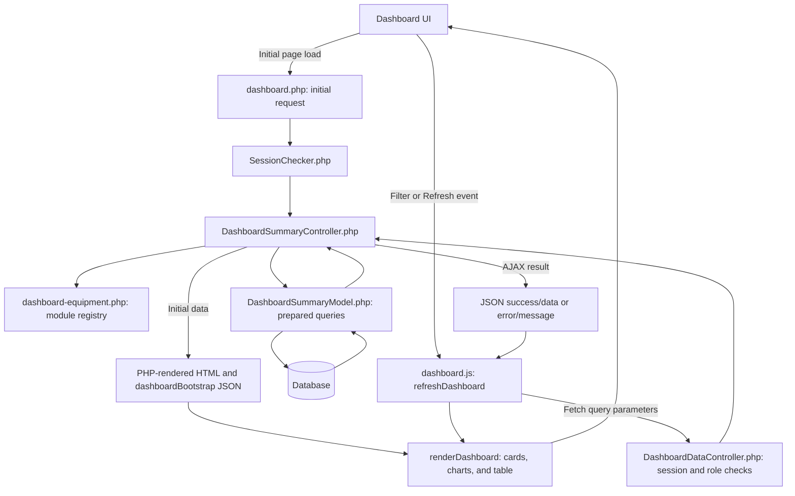

# Dashboard implementation guide

This guide describes the code inspected on November 6, 2026. Paths are relative to the project root. It documents the current implementation, not proposed features.

The application uses procedural PHP functions, mysqli database access, vanilla JavaScript, Bootstrap, and Chart.js. A Controller validates input and prepares page data; a Model contains SQL and reads database records. The frontend displays the returned values.

## 1. Dashboard overview

`dashboard.php` gives signed-in users a branch-scoped view of fire equipment and inspection progress.

**Inventory Overview** means current active inventory. These counts depend on the branch and archive flag, not the inspection dates. Selecting an older period does not reconstruct inventory as it existed then.

**Inspection Monitoring** means inspection activity in the selected period. Inspection dates affect inspected units, remaining units, submissions, coverage, monthly bars, and the history Period Total.

The current page provides:

- Inspection-period controls, optional custom dates, an Admin branch selector, and Refresh.
- Four summary cards: Total Active Equipment, Unique Equipment Inspected, Total Inspection Submissions, and Equipment Not Yet Inspected.
- Equipment cards showing current active units, inspection coverage, inspected units, remaining units, and inventory links.
- A flip card showing the uninspected count by equipment type.
- Monthly inspection bars, a coverage doughnut, an inventory-distribution list, and a monthly-count table.
- An updated timestamp, loading/error messages, and an expired-session sign-in link.
- A separate fire-extinguisher expiration notice and the shared session-timeout interface.

The current registry contains Fire Extinguisher and Chemical Spill Kit. Their labels and Model function names are configured on the backend. Equipment types are not discovered automatically from database tables.

## 2. Project file structure

### Dashboard implementation

| File | Responsibility |
|---|---|
| [dashboard.php](dashboard.php) | Frontend PHP entry point. Loads session checking, retrieves initial data, renders filters and cards, and embeds initial JSON. |
| [backend/controller/DashboardSummaryController.php](backend/controller/DashboardSummaryController.php) | Validates role, branch, and dates; calls equipment Models; combines totals and monthly data. |
| [backend/controller/DashboardDataController.php](backend/controller/DashboardDataController.php) | JSON endpoint used by JavaScript. Checks the session and returns data or an error response. |
| [backend/model/DashboardSummaryModel.php](backend/model/DashboardSummaryModel.php) | Contains the active-inventory, inspection-history, monthly-count, and branch-option queries. |
| [backend/config/dashboard-equipment.php](backend/config/dashboard-equipment.php) | Equipment registry returned by `getDashboardEquipmentRegistry()`. Defines IDs, labels, icons, colors, inventory URLs, and summary functions. |
| [partials/dashboard-equipment-card.php](partials/dashboard-equipment-card.php) | Shared markup for initial equipment cards and the JavaScript cloning template. |
| [partials/dashboard-uninspected-card.php](partials/dashboard-uninspected-card.php) | Front and back faces of the uninspected summary card. |
| [js/dashboard.js](js/dashboard.js) | Filter events, Fetch requests, DOM updates, Chart.js updates, and flip-card interaction. |
| [css/dashboard.css](css/dashboard.css) | Dashboard-specific appearance, chart dimensions, loading feedback, and scoped flip styles. |
| [documentation/dashboard.md](documentation/dashboard.md) | Existing shorter dashboard reference. |

### Supporting files

| File | Dashboard use |
|---|---|
| `backend/config/db.php` | Creates the shared mysqli connection `$conn` and sets `utf8mb4`. Connection credentials must not be copied into documentation. |
| `backend/authentication/SessionChecker.php` | Protects the initial page and updates session activity. |
| `partials/header.php` | Loads shared CSS/JavaScript, Bootstrap 5.3.3, Bootstrap Icons 1.11.3, and Chart.js from a CDN. The Chart.js URL does not pin a version. |
| `partials/side-nav.php`, `partials/header-nav.php`, `partials/footer.php` | Shared application shell, included without dashboard-specific replacements. |
| `css/style.css` | Shared CoreUI/application styling underneath the dashboard appearance layer. |
| `vendors/@coreui/coreui/js/coreui.bundle.min.js`, `vendors/simplebar/js/simplebar.min.js` | Shared navigation and scrolling support loaded by the page. |
| `notification/fe-expiration-notice.php` | Server-rendered expiration notice shown at most once per session when its count is positive. |
| `backend/controller/DashboardController.php`, `backend/model/DashboardModel.php` | Legacy dashboard functions. The current page still needs their expiration-count path, but the summary cards/charts use the newer Summary files. |
| `backend/controller/FireExtinguisherController.php` | Included by the expiration notice; it is not the summary JSON endpoint. |
| `notification/session_timeout.php` | Shared inactivity warning and session-extension behavior. It calls `backend/authentication/Auth.php` and uses the shared logout/login paths. |

Do not assume every function in the legacy Dashboard files is displayed on the current page.

## 3. Backend implementation

### Initial page request

1. `dashboard.php` requires `SessionChecker.php`.
2. It loads the Summary Controller and the legacy Dashboard Controller needed for expiration counts.
3. It calls `getDashboardSummaryData($_GET, $_SESSION)`.
4. The result becomes `$initialData`. The page derives `$filters`, `$summary`, and `$equipmentCards` from it.
5. Invalid-input/access messages are displayed directly. Unexpected failures are logged and shown as a general loading error.
6. PHP renders the page and embeds `{data, error}` in `<script type="application/json" id="dashboardBootstrap">`.

`dashboardEscape()` applies `htmlspecialchars()` to displayed values. Embedded JSON uses the `JSON_HEX_*` flags. Dashboard CSS is appended after the shared head through output buffering; the shared header itself is not rewritten on disk.

### Summary Controller

`resolveDashboardSummaryFilters()` resolves the permitted branch and date range. `dashboardDateValue()` checks a real `YYYY-MM-DD` calendar date in Asia/Manila time.

`getDashboardSummaryData()` then:

1. Initializes totals and a list of month labels.
2. Loops through `getDashboardEquipmentRegistry()`.
3. Calls each configured `summary_function` with the resolved filters.
4. Adds that equipment's counts to `$totals`.
5. Fills missing months with zero so every chart series uses the same month axis.
6. Combines current/previous-calendar-month counts into `$comparison`.
7. Removes internal summary-function names from returned equipment definitions.
8. Adds active branch choices for Admin and a Manila-formatted `generated_at` timestamp.

### Model and connection

`dashboardSummarySelect($sql, $parameterTypes, $parameters)` uses the existing global `$conn`. It prepares the statement, binds values, executes it, fetches associative rows, frees the result, and closes the statement in `finally`.

A prepared statement keeps supplied values separate from SQL. Table/column identifiers are supplied by the equipment Model functions, not by URL parameters.

`getDashboardFireExtinguisherSummary()` and `getDashboardChemicalSpillKitSummary()` call `dashboardEquipmentSummary()` with their respective table and key names. The common function also calls `dashboardEquipmentHistoryCounts()` and `dashboardEquipmentMonthlyCounts()`.

## 4. Database tables and queries

### Tables used by the summary dashboard

| Table | Fields used | Purpose |
|---|---|---|
| `fire_extinguishers_tbl` | `extinguisher_code`, `branch`, `archived` | Current distinct active extinguishers. |
| `inspection_checklist_tbl` | `extinguisher_code`, `branch`, `date_inspected` | Extinguisher inspection submissions and distinct inspected units. |
| `chemical_spill_kit_materials_inventory_tbl` | `chemical_spill_kit_id`, `branch`, `archived` | Distinct active kits, despite multiple material rows. |
| `chemical_spill_kit_inspection_tbl` | `chemical_spill_kit_id`, `branch`, `inspection_date` | Kit inspection headers and inspected identities. |
| `maintenance_dropdown_tbl` | `category`, `status`, `value` | Admin branch options where category is `branch` and status is `active`. |

The summary queries do not read `transactions_tbl` and do not join an approval/evaluation table.

### Inventory and inspected units

The summary uses a correlated `EXISTS` check rather than a SQL `JOIN`. `EXISTS` asks whether at least one matching inspection is present for each inventory identity. It prevents repeat inspections from multiplying the active-inventory count.

The following is the extinguisher expansion of the actual common query for `branch=all`. Question marks are bound start/end timestamps.

```sql
SELECT COUNT(*) AS active,
       COALESCE(SUM(EXISTS (
           SELECT 1
           FROM inspection_checklist_tbl i
           WHERE i.extinguisher_code = k.equipment_key
             AND LOWER(TRIM(i.branch)) = LOWER(TRIM(k.branch))
             AND i.date_inspected >= ?
             AND i.date_inspected < ?
       )), 0) AS inspected
FROM (
    SELECT DISTINCT k.extinguisher_code AS equipment_key, k.branch
    FROM fire_extinguishers_tbl k
    WHERE k.archived = 0
) k
```

For a selected branch, the inner inventory query additionally contains:

```sql
AND LOWER(TRIM(k.branch)) = LOWER(TRIM(?))
```

The inspection must match both the equipment key and branch. `LOWER(TRIM(...))` ignores case and surrounding spaces for branch matching. The kit query uses the same structure with kit tables, `chemical_spill_kit_id`, and `inspection_date`.

Dates occur only inside the inspection check. They do not restrict the outer active inventory.

### History and monthly counts

The actual extinguisher form of the all-branch history query is:

```sql
SELECT COUNT(*) AS submissions,
       COUNT(DISTINCT i.extinguisher_code, i.branch) AS unique_equipment
FROM inspection_checklist_tbl i
WHERE i.date_inspected >= ?
  AND i.date_inspected < ?
```

A branch-specific request adds the normalized branch predicate. History is read directly from inspection headers; it does not require a current active-inventory match. Archived units' inspection records can therefore contribute.

Monthly counts use the same date/branch predicates, with:

```sql
SELECT DATE_FORMAT(i.date_inspected, '%Y-%m') AS month,
       COUNT(DISTINCT i.extinguisher_code, i.branch) AS inspected
FROM inspection_checklist_tbl i
WHERE i.date_inspected >= ?
  AND i.date_inspected < ?
GROUP BY DATE_FORMAT(i.date_inspected, '%Y-%m')
ORDER BY month
```

A unit inspected in two months contributes once to each month but once to the whole-range unique count. Do not add monthly bars to obtain Period Total.

### Calculated values

| Response value | Meaning |
|---|---|
| `active` | Distinct current inventory identities with `archived = 0` in the permitted branch scope. |
| `inspected` | Active identities with at least one matching inspection in the range. |
| `not_inspected` | `active - inspected`. |
| `submissions` | All matching inspection header records, including repeats. |
| `history_unique` | Distinct inspected identities across the whole range, including archived history. |
| `equipment[].monthly` | One count per month in the Controller's month list, with missing months filled with zero. |

These counts are calculated for each registered equipment module and summed for overall totals. Identity is equipment key plus branch within a module; totals sum across modules.

### Legacy condition and expiration queries

`DashboardModel.php` still contains condition and placement helpers:

- `getAllGoodCondition()` and `getAllNotGoodCondition()` filter `condition_status = 'Good'` or `'No Good'`, `archived = 0`, and branch.
- Installed helpers use `placement != 'Spare'`; spare helpers use `placement = 'Spare'`.
- These condition/placement figures are not returned in the current Summary response or displayed as current summary cards.

The expiration notice calls `getAllExpiringCount()`, which delegates to `getExpiringFireExtinguishers()`. That query counts nonarchived extinguishers with `expiration_date` between database `CURDATE()` and two months later, inclusive. It uses the legacy `getDashboardBranch()` resolver.

The notice is generated during page rendering and is not refreshed by the dashboard Fetch endpoint.

## 5. Frontend implementation

The page has a Bootstrap container, heading, filter form, status/sign-in area, summary row, equipment row, and analytics row.

The four statistics use `data-summary` attributes. Equipment cards use `data-equipment` and `data-module-value` attributes so JavaScript can find the correct values without replacing the whole page.

`partials/dashboard-equipment-card.php` is used twice: once for each initial record and once inside `#dashboardEquipmentTemplate`. JavaScript clones that template when a new equipment ID appears and removes cards no longer returned.

### Uninspected flip card

`partials/dashboard-uninspected-card.php` keeps the headline count and description on the front. Its back uses the same equipment summaries and displays only positive `not_inspected` counts.

`flipUninspected()` toggles `is-flipped`, `aria-hidden`, `aria-expanded`, and `inert`. The inactive face is excluded from keyboard interaction. Enter/Space opens the card; Back or Escape returns to the front.

The front remains in normal document flow and determines the card's dimensions. The back is absolutely positioned over that area. Its list has `flex-grow-1 overflow-auto` and `min-height: 0`; the heading, total, and Back button remain outside the scrollable list.

`updateUninspectedBreakdown()` caches a signature of the total and positive rows to avoid rebuilding an unchanged list. It compares the returned breakdown sum with the headline total and displays a mismatch instead of inventing an extra category.

### Custom CSS

`css/dashboard.css` supplements Bootstrap with dashboard typography, navy/gray/amber colors, borders, rounded corners, icon sizes, focus outlines, and subtle card shadows.

It also supplies bounded Chart.js parent dimensions: the monthly chart uses `clamp(240px, 30vw, 280px)` and the doughnut parent has a 190px height and 240px maximum width. Those are canvas constraints, not a responsive page grid.

The flip transition lasts 180ms. Loading feedback dims dashboard sections and rotates the Refresh icon while a request is active. Reduced-motion rules disable dashboard animations and transitions. There is no custom breakpoint-based grid in this stylesheet.

## 6. JavaScript and Fetch requests

### Initial data

On `DOMContentLoaded`, `js/dashboard.js` finds the controls and parses `#dashboardBootstrap`. If initial data exists, it calls `renderDashboard(initialResponse.data, true)` without making a duplicate data request. An initial server error remains visible rather than being automatically retried.

The initial cards and controls are rendered by PHP. Interactive updates, charts, and the generated monthly table require JavaScript.

### Request parameters

`getDashboardParameters()` builds `URLSearchParams` for:

| Parameter | Sent when | Meaning |
|---|---|---|
| `period` | Every dashboard refresh | One of the allowed period keys. |
| `branch` | The branch select exists | Admin-selected branch or `all`. Assigned-role pages omit this control. |
| `from` | `period=custom` | Inclusive first inspection date. |
| `to` | `period=custom` | Inclusive final inspection date. |

For example, this is a request shape, not a hardcoded branch or count:

```text
backend/controller/DashboardDataController.php?period=custom&branch=all&from=2026-10-01&to=2026-10-31
```

The actual Fetch call in `refreshDashboard()` is:

```javascript
const response = await fetch(endpoint + '?' + params.toString(), {
    credentials: 'same-origin',
    cache: 'no-store',
    signal: pendingRequest.signal
});
```

`endpoint` is `backend/controller/DashboardDataController.php`. Session cookies stay on the same origin, caching is disabled for this request, and `AbortController` permits cancellation.

### Response shape

Success returns `{success: true, data: ...}`. The data contains:

| Field | Contents |
|---|---|
| `filters` | Resolved branch, period, display dates, SQL timestamps, comparison dates, and `can_select_branch`. |
| `totals` | `active`, `inspected`, `submissions`, `not_inspected`, `history_unique`. |
| `equipment` | Each registered type's metadata, counts, and monthly array. Internal `summary_function` names are omitted. |
| `months` | Objects with `key` such as `2026-11` and a display `label`. |
| `comparison` | `current`, `previous`, and readable `text`. |
| `branches` | Active dropdown values for Admin; otherwise an empty array. |
| `generated_at` | Server-generated Manila-formatted update time. |

Errors normally return `{success: false, message: ...}`.

### Refresh and rendering sequence

`refreshDashboard()`:

1. Stops if the client has already detected an expired session.
2. Cancels the previous request and increments `latestRequestId`.
3. Applies custom-date requirements and browser validation.
4. Replaces the filter parameters in the current URL using `history.replaceState()`.
5. Starts a 20-second timeout, sets `aria-busy`, and displays loading feedback.
6. Fetches the endpoint and checks the HTTP status and JSON success/data fields.
7. Ignores stale responses whose request ID is no longer current.
8. Calls `renderDashboard()` and clears the status after success.
9. Preserves the previous successful results after failure and clears loading state for the current request.

`renderDashboard()` updates statistics, timestamps, labels, and controls, then calls `updateUninspectedBreakdown()`, `updateEquipmentCards()`, and `updateCharts()`.

`updateCharts()` updates legends, inventory distribution, and the monthly table before updating the two canvas charts. Existing chart instances receive new `data` and `update()` calls rather than being recreated on every filter change.

If Chart.js is missing, the canvases are hidden and a message points to the monthly table. That table still requires `dashboard.js` to execute.

### Events and errors

Form submission, period changes, and Admin branch changes call the same refresh function. Date-input changes refresh when both dates have values. A `popstate` handler restores URL filters and refreshes when browser navigation changes the URL.

The endpoint uses these status codes:

| Status | Behavior |
|---|---|
| 200 | Successful data response. |
| 400 | Invalid filter input. |
| 401 | Missing or expired session. |
| 403 | Unsupported role or missing required branch assignment. |
| 500 | Unexpected exception; details logged server-side, general message returned. |

HTTP 401 or a redirected Fetch response reveals `#dashboardSignIn` and prevents further dashboard refreshes until sign-in/reload. Other failures show `#dashboardStatus`. A timeout is described as a timed-out request; malformed JSON gets a general loading error.

Connection failure is a separate current-code limitation: `backend/config/db.php` calls `die("Database connection failed.")`. That can bypass the endpoint's JSON exception response; the frontend's malformed-JSON handling is relevant here. No fix is included in this documentation.

## 7. Filters and business logic

### Branch filter

`resolveDashboardSummaryFilters()` lowercases/trims the role and accepts Admin, Inspector, and Super Admin.

Admin branch resolution uses the request value if present, otherwise the session branch, otherwise `all`. An empty resolved value falls back to a nonempty session branch or `all`. Branch input must be a string and at most 400 bytes.

Branch dropdown choices come from active `maintenance_dropdown_tbl` entries. The Controller does not enforce membership in that dropdown list; it validates the value's type/length and the Model applies it through a prepared branch predicate. The page preserves a selected branch even if it is absent from the active choices.

Inspector and Super Admin ignore a requested branch and use `$_SESSION['Branch']`. An empty assignment or an assignment equal to `all`, ignoring case, is rejected.

Changing the Admin selector refetches totals, equipment cards, history, charts, and labels for the selected branch.

### Date filter

All ranges start at midnight. SQL includes `start` and excludes `end`, where `end` is midnight after the last included date.

| Key | Label | Actual range |
|---|---|---|
| `today` | Today | Today only. |
| `yesterday` | Yesterday | Yesterday only. |
| `last_7` | Last 7 Days | Today and the preceding six days. |
| `last_30` | Last 30 Days | Today and the preceding 29 days. |
| `this_month` | This Month | Entire current calendar month; the default. |
| `last_month` | Last Month | Entire previous calendar month. |
| `custom` | Custom Date Range | Valid `from` through `to`, inclusive. |

Custom dates must be real dates, at least year 1000, with start no later than end. An end date of 9999-12-31 is rejected because the query needs to calculate the following midnight. Noncustom periods are resolved on the server; supplied `from`/`to` values are not used for them.

PHP constructs these ranges in Asia/Manila time. This inspection did not verify the database session timezone or the stored timestamps' timezone; see Section 13.

### Inventory Overview

Inspection dates do not affect `totals.active`, `equipment[].active`, or inventory distribution. Inventory always uses current distinct nonarchived identities within the permitted branch.

Equipment cards combine that current inventory with date-filtered coverage. Their inspected/remaining labels can change while their active count stays constant.

The current summary does not calculate condition or installed/spare totals. Those remain legacy functions, described in Section 4.

### Inspection Monitoring

Any matching inspection header qualifies; these queries do not require Approved status and do not exclude Pending or Rejected records by an evaluation-status predicate.

Active coverage, historical unique equipment, and submission totals are different measures. They should not be compared as if all counted the same rows.

The comparison always uses the previous and current whole calendar months in the selected branch, regardless of the chosen period. Its text describes the count difference, not a percentage. Missing inspection months are filled with zero for chart alignment.

## 8. User roles and session access

| Role | Branch selector | Effective branch for summary data |
|---|---|---|
| Admin | Shown | Request/session branch, with the existing `all` fallback. |
| Inspector | Hidden; assigned branch shown | Session assignment only. |
| Super Admin | Hidden; assigned branch shown | Session assignment only; summary access still requires a branch. |
| Other roles | Not permitted by the summary endpoint | 403. |

Do not infer all-branch summary access from the Super Admin role name.

The initial page uses `SessionChecker.php`. The JSON endpoint repeats the cookie/activity policy so it can return JSON rather than redirecting. It requires `$_SESSION['id']` and rejects activity older than 310 seconds when `LAST_ACTIVITY` exists. It updates activity, checks the role, and releases the session lock before querying.

Cookie settings include a 3600-second lifetime, HttpOnly, SameSite=Lax, and Secure when HTTPS is detected. Cookie lifetime is separate from the inactivity timeout.

The shared `notification/session_timeout.php` adds its own client-side warning and session heartbeat/extension logic; it is not part of the dashboard data refresh function.

The legacy expiration branch resolver checks the literal role `Admin` and differs from the normalized Summary resolver. Keep those paths separate when investigating an expiration notice that differs from a summary card.

## 9. Data flow



The expiration notice and shared session heartbeat are supporting paths, separate from the summary-data request shown above.

## 10. Responsive design

Bootstrap 5.3.3 is loaded by the shared header. The dashboard uses `container-fluid`, `row`, gutters, responsive columns, cards, form controls, buttons, progress bars, and spacing/flex utilities.

| Area | Current classes | Result |
|---|---|---|
| Main container | `px-3 px-md-4 px-xl-5 py-3 py-md-4` | Compact padding on small screens, more space on larger screens. |
| Summary cards | `col-12 col-sm-6 col-xl-3` | One per row below 576px, two from 576px, four from 1200px. |
| Equipment cards | `col-12 col-md-6` | One per row below 768px, two from 768px. |
| Main chart / side charts | `col-12 col-xl-8` / `col-12 col-xl-4` | Stack below 1200px; use an 8/4 split above it. |
| Two side panels | `col-12 col-md-6 col-xl-12` | Stack on mobile, sit side by side at tablet widths, stack in the desktop side column. |
| Period/branch fields | `col-12 col-sm-6 col-lg-4 col-xxl-3` | Full width on mobile, narrower responsive columns on larger screens. |
| Custom-date group | `col-12 col-lg-8 col-xxl-4` | Full row until large screens; nested date inputs use `col-12 col-sm-6`. |
| Refresh wrapper | `col-12 col-sm-auto ms-sm-auto` | Full-width mobile action; compact right-aligned action from the small breakpoint. |
| Monthly table | `table-responsive` | Allows horizontal scrolling inside its own wrapper. |

The named Bootstrap breakpoints used here are sm=576px, md=768px, lg=992px, xl=1200px, and xxl=1400px.

Bootstrap breakpoints follow viewport width. The shared sidebar also occupies desktop space, so test the dashboard with the real navigation visible. Source-defined layouts are described here; this documentation task did not rerun visual device tests.

## 11. Important functions

| Function | File | Purpose |
|---|---|---|
| `dashboardEscape()` | `dashboard.php` | Escape displayed HTML values. |
| `getDashboardEquipmentRegistry()` | `backend/config/dashboard-equipment.php` | Return supported equipment definitions and their Model callbacks. |
| `dashboardDateValue()` | `backend/controller/DashboardSummaryController.php` | Validate and parse a calendar date. |
| `resolveDashboardSummaryFilters()` | Same Controller | Enforce role/branch rules and construct inspection/comparison ranges. |
| `getDashboardSummaryData()` | Same Controller | Assemble totals, equipment, month labels, comparisons, branch options, and timestamp. |
| `dashboardSummarySelect()` | `backend/model/DashboardSummaryModel.php` | Execute a prepared read query through `$conn`. |
| `getDashboardSummaryBranches()` | Same Model | Read active branch dropdown values. |
| `getDashboardFireExtinguisherSummary()` | Same Model | Supply extinguisher table/key mappings. |
| `getDashboardChemicalSpillKitSummary()` | Same Model | Supply kit table/key mappings. |
| `dashboardEquipmentSummary()` | Same Model | Calculate current active/inspected/remaining counts and collect history. |
| `dashboardEquipmentHistoryCounts()` | Same Model | Count range submissions and distinct historical identities. |
| `dashboardEquipmentMonthlyCounts()` | Same Model | Count distinct inspected identities per month. |
| `getDashboardBranch()` | `backend/controller/DashboardController.php` | Legacy branch resolution used by the expiration path. |
| `getAllExpiringCount()` | Same legacy Controller | Request the expiration count for that branch. |
| `getExpiringFireExtinguishers()` | `backend/model/DashboardModel.php` | Query active extinguishers expiring within two months. |
| `refreshDashboard()` | `js/dashboard.js` | Validate controls, fetch data, manage cancellation/timeouts, and handle errors. |
| `getDashboardParameters()` | Same JavaScript file | Build endpoint filter parameters. |
| `updateCustomDateFields()` | Same JavaScript file | Show/require custom date inputs and set the minimum end date. |
| `renderDashboard()` | Same JavaScript file | Apply the returned response across the dashboard. |
| `showStatus()` | Same JavaScript file | Display loading/error messages. |
| `updateEquipmentCards()` | Same JavaScript file | Update, clone, or remove equipment cards. |
| `updateUninspectedBreakdown()` | Same JavaScript file | Update positive remaining counts and mismatch feedback. |
| `flipUninspected()` | Same JavaScript file | Switch card faces and focus. |
| `createLegendItem()` | Same JavaScript file | Create a safe text-based legend entry. |
| `updateChartLegends()` | Same JavaScript file | Refresh labels and the displayed coverage percentage. |
| `updateEquipmentDistribution()` | Same JavaScript file | Render current inventory distribution bars and counts. |
| `updateMonthlyTable()` | Same JavaScript file | Build the accessible alternative monthly-count table. |
| `updateMonthlyChart()` | Same JavaScript file | Create/update the monthly bar chart. |
| `updateCoverageChart()` | Same JavaScript file | Create/update the coverage doughnut. |
| `updateCharts()` | Same JavaScript file | Coordinate legends, table, distribution, and Chart.js availability. |

`DashboardDataController.php` executes request-handling code at file scope; it is not a class or a named endpoint function.

## 12. Maintenance guide

### Add a Dashboard statistic

1. Decide whether it describes current inventory or selected-period inspections.
2. Put required SQL in `DashboardSummaryModel.php`; reuse existing queries if they already return the value.
3. Add the response value to `getDashboardSummaryData()`. Update overall accumulation if it is a cross-equipment total.
4. Add markup in `dashboard.php` or the appropriate existing partial.
5. For an overall statistic, a matching `data-summary` key allows `renderDashboard()` to update it automatically. Add rendering logic if its response shape differs.
6. Check both first-page rendering and Fetch refreshes.

Do not treat condition data from the legacy Model as part of the current Summary response without explicitly wiring it through.

### Add an equipment module

Add a Model wrapper for verified inventory/inspection tables, then a definition in `dashboard-equipment.php` containing the expected metadata and `summary_function`. Return the same summary keys/monthly data shape. The existing Controller and frontend loops can then include it.

This requires backend integration. Merely adding a new database table or transaction category does not register a Dashboard module.

### Modify SQL

Open the relevant Model function and verify the live schema before changing columns or joins. Preserve distinct identity, branch matching, archive rules, date boundaries, and the existing definition of inspected unless an intentional business-rule change is requested.

When adding/removing placeholders, keep `$parameterTypes` and `$parameters` in the same order. Compare all-branch and assigned-branch results, repeat-inspection behavior, and archived history. Never put SQL into `dashboard.php` or JavaScript.

### Add a filter

Update the form in `dashboard.php`, `getDashboardParameters()`, `resolveDashboardSummaryFilters()`, and the relevant Model predicates. Also update returned `filters`, `renderDashboard()` control synchronization, and URL restoration/removal in the `popstate` and refresh handlers.

Both page loads and AJAX must resolve the filter the same way. Keep the server authoritative for branch access.

### Modify a chart or card

For charts, change `updateMonthlyChart()` or `updateCoverageChart()`. If the data meaning changes, update legends, `updateMonthlyTable()`, labels, and the Model/Controller together.

For equipment cards, change `partials/dashboard-equipment-card.php` so initial and cloned cards stay aligned. Preserve selectors used by `updateEquipmentCards()`. For the flip card, preserve its face IDs, focus handling, list constraint, and count selectors.

Use Bootstrap layout utilities first. Keep additional appearance rules scoped in `css/dashboard.css`.

### Troubleshoot incorrect statistics

1. Check the returned `filters` in browser developer tools, including branch and exclusive `end`.
2. Identify which measure is wrong: active inventory, coverage, submissions, or historical unique equipment.
3. Check the configured Model callback and equipment key/branch pair.
4. Compare inventory identities, archived flags, matching inspection dates, and repeated records.
5. Check raw response numbers before debugging chart rendering.
6. Verify `active = inspected + not_inspected` and overall totals against per-equipment sums.
7. Remember that historical/monthly counts include archived history, while active coverage does not.
8. For the expiration notice, inspect the legacy branch/count functions instead of the Summary endpoint.

A monthly sum exceeding Period Total is not, by itself, an error.

### Troubleshoot Fetch errors

Use the browser Network tab to inspect `DashboardDataController.php`, its query parameters, HTTP status, and response body. Check the Console for JavaScript/Chart.js loading errors and PHP logs for server exceptions.

For 401, sign in again. For 403, check role and assigned branch. For 400, inspect period/date/branch input. For 500 or malformed JSON, inspect database connectivity and PHP output before changing frontend code.

If the request succeeds but the page is stale, check `renderDashboard()` selectors and request cancellation. If only a chart is missing, inspect CDN loading and the generated monthly table. No dashboard polling interval is implemented; refreshes come from the documented events.

## 13. Implementation rules and verification limits

Preserve these source-verified rules:

- Inventory counts stay independent of inspection dates.
- Only Admin selects summary branch scope; assigned roles cannot override it.
- Current coverage uses distinct nonarchived equipment identities and matching key/branch inspections.
- Historical counts may include archived units and repeat submissions; period uniqueness differs from monthly uniqueness.
- No approval-status restriction is silently added to the existing summary counts.
- Date ranges use an inclusive start and exclusive following-midnight end.
- PHP Models own SQL, Controllers validate/assemble data, and frontend files render it.
- Initial and Fetch responses use the same Summary Controller.
- Keep response keys, DOM selectors, and equipment-template markup aligned.
- Bootstrap remains the layout foundation; chart sizing and flip effects remain scoped enhancements.
- Equipment modules are registered on the backend, not inferred from arbitrary client input.

**Verified for this documentation:** current source paths, functions, predicates, UI classes, response structure, and control flow were inspected.

**Unverified in this documentation pass:** live schema/index definitions, deployment database/timezone configuration, actual current row counts, resolved CDN Chart.js version, browser rendering on physical devices, and performance on a 4GB RAM device. The existing shorter documentation records earlier tests; those were not rerun for this documentation-only task.

No application behavior or database content was changed while writing this guide.
